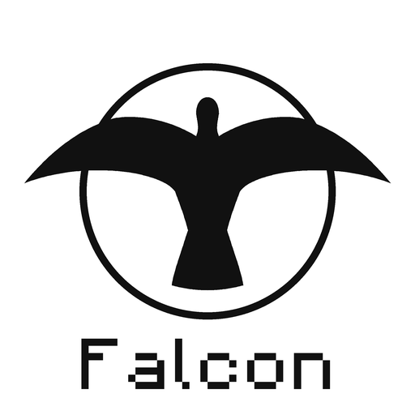

	<picture>
		<source media="(prefers-color-scheme: dark)" srcset="logo-white.png">
		
	</picture>
	 
	<b>Minecraft: Bedrock Edition server software written from scratch in C++</b>
	 
	Not affiliated with Mojang AB.

	
	
	
	
	
	

Falcon is a Minecraft: Bedrock Edition server built from the ground up in C++17. The protocol, world
storage, inventory, movement and gameplay systems are all reimplemented by hand, with no runtime to
install: the server ships as a single self-contained executable.

Learn more on the website: **[falcon-mc.github.io](https://falcon-mc.github.io)**.

## Repositories

| Repository | Description | Build |
|---|---|---|
| [Falcon](https://github.com/Falcon-MC/Falcon) | The server: world, gameplay, commands, generation, scripting and plugins. It also holds the libraries below |  |
| [Falcon.Protocol](https://github.com/Falcon-MC/Falcon/tree/dev/Falcon.Protocol) | Bedrock packets and network types | |
| [Falcon.Network](https://github.com/Falcon-MC/Falcon/tree/dev/Falcon.Network) | Transport layer: RakNet, NetherNet (WebRTC), compression and login verification | |
| [Falcon.Shared](https://github.com/Falcon-MC/Falcon/tree/dev/Falcon.Shared) | NBT, binary streams, JSON, math and logging | |
| [BedrockData](https://github.com/Falcon-MC/BedrockData) | Game data files, versioned by protocol | |
| [BlockStateUpdater](https://github.com/Falcon-MC/BlockStateUpdater) | Block state upgrade schemas | |
| [PluginAPI](https://github.com/Falcon-MC/PluginAPI) | Plugin API | |

## Getting started

Download the latest Windows, Linux or macOS build from the [releases](https://github.com/Falcon-MC/Falcon/releases).
Each binary comes with a `.sha256` checksum. To build it yourself, follow the instructions in the
[Falcon README](https://github.com/Falcon-MC/Falcon#building).

## License

Falcon is licensed under the
[GNU Lesser General Public License v3.0](https://github.com/Falcon-MC/Falcon/blob/main/LICENSE).
